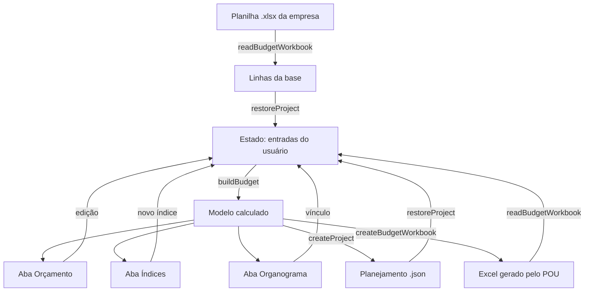

# Visão geral

Apresenta o planejador, suas tecnologias e o fluxo de trabalho.
<details>
<summary> Arquivos de código usados nesta página</summary>

Esta página foi escrita a partir destes arquivos:

- [package.json](../../package.json)
- [index.html](../../index.html)
- [build.mjs](../../scripts/build.mjs)
- [server.mjs](../../scripts/server.mjs)
- [README.md (guia do usuário)](../README.md)

</details>


> **Páginas relacionadas**: [Arquitetura](02_arquitetura.md), [Manutenção](08_manutencao.md)

---

## O que é o POU

O POU (Planejador Orçamentário Universal) é um site de uma página só. Ele faz cinco coisas em sequência:

1. Importa a planilha da empresa, com o Realizado de receitas e despesas.
2. Projeta os meses seguintes até o ano escolhido.
3. Aplica índices econômicos e as edições feitas à mão.
4. Distribui o Realizado entre setores administrativos (organograma).
5. Exporta um Excel com fórmulas que o próprio site consegue reabrir.

A tela segue essas etapas: Importar, Configurar, Analisar e Exportar ([index.html](../../index.html)).

O guia de uso do site está em [docs/README.md](../README.md) e na Central de ajuda da página ([index.html](../../index.html)).

| Termo | No código | Significado |
|-------|-----------|-------------|
| Realizado | `actual`, `record.actuals` | Valor que aconteceu. Vem da planilha ou de edição manual. |
| Projetado | `projected`, `record.final` | Valor estimado para o mês. |
| Conta / rubrica | `record` (`account`, `rubric`) | Linha analítica de 14 dígitos da planilha. |
| Setor da base | `sectorCode`, `model.sectors` | Grupo de contas da própria planilha (3 primeiros dígitos). |
| Setor administrativo | `box` | Área da empresa criada no organograma. |
| Vínculo | `link` | Percentual de uma conta ou setor da base atribuído a um setor administrativo. |
| Índice | `variable` | Aumento ou redução percentual aplicado ao Projetado. |
| Ano de referência | `targetYear` | Ano mais recente encontrado nas colunas mensais da base. |

Sources: [index.html](../../index.html), [README.md](../README.md)

---

## Tecnologia e restrições

O site usa **HTML, CSS e JavaScript puro**, sem framework. A única biblioteca JavaScript externa permitida é o **JSZip**, já incluído no repositório. Usar o planejador não exige NPM, instalação de pacotes, Node.js, servidor ou internet. O `package.json` identifica os fontes como módulos ES para as ferramentas locais e mantém atalhos opcionais; não declara dependências.

A única biblioteca externa do site é o **JSZip**, guardado no repositório em `scripts/vendor/jszip.min.js`. Ele compacta e descompacta o `.xlsx`, que é um ZIP de arquivos XML. A página carrega o JSZip antes do bundle ([index.html](../../index.html)). A geração da documentação usa ferramentas externas do ambiente de manutenção, sem incorporá-las à aplicação. O HTML pronto contém os recursos necessários à leitura offline. Ícones SVG e fonte são arquivos locais. Veja [Preparação e geração](../setup.md).

Três restrições orientam todo o código:

| Restrição | Consequência no código |
|-----------|------------------------|
| **Abrir com dois cliques no `index.html`** (protocolo `file://`) | O navegador bloqueia módulos ES em `file://`. Por isso existe o `app.bundle.js` ([build.mjs](../../scripts/build.mjs)), e um teste garante que a página não usa `type="module"`. |
| **Nada sai do computador** | Nenhum `fetch` nem servidor de dados. Os arquivos são lidos com `File.text()`/`arrayBuffer()` e salvos com um link de download ([dom.js](../../scripts/views/dom.js)). |
| **Excel é o formato de troca** | O `.xlsx` é montado à mão, em XML, para controlar fórmulas, estilos e gráficos. Veja [Excel](06_excel.md). |

O servidor `node scripts/server.mjs` é só uma conveniência de desenvolvimento. Ele escuta apenas em `127.0.0.1` e recusa caminhos fora da pasta ([server.mjs](../../scripts/server.mjs)).

Sources: [package.json](../../package.json), [build.mjs](../../scripts/build.mjs), [server.mjs](../../scripts/server.mjs)

---

## Estrutura de pastas

```text
planejador_orcamentario/
├── index.html              página única (tela + Central de ajuda)
├── package.json            módulos ES e atalhos opcionais; sem dependências
├── styles/styles.css       todo o CSS, na ordem das seções da página
├── images/                 logo, favicon, ícones (Lucide) e fonte Manrope
├── docs/
│   ├── README.md           guia do usuário
│   ├── backlog.md          histórico de mudanças
│   ├── setup.md            abertura local e manutenção
│   ├── index.html          GERADO: documentação offline
│   ├── images/             diagramas locais
│   ├── GUIA_LLM_*.md       como pedir a uma IA um JSON de índices ou organograma
│   └── wiki/               páginas técnicas em Markdown
├── tests/                  testes e fixtures (node --test)
└── scripts/
    ├── models/             orçamento, organograma e estado/histórico
    ├── views/              tabelas, campos, gráficos, diálogos e formatação
    ├── controllers/        ações do usuário e coordenação das telas
    ├── export/             planejamento JSON e leitura/geração de Excel
    ├── vendor/             JSZip e licença
    ├── build.mjs           gera app.bundle.js
    ├── build-docs.mjs      gera docs/index.html via offline-docs
    ├── server.mjs          servidor local opcional
    └── app.bundle.js       GERADO: não edite à mão
```

A organização segue MVC. Os **models** mantêm dados e regras sem acessar a página. As **views** apresentam informações e os **controllers** recebem ações e coordenam as alterações. A pasta **export** concentra a conversão dos arquivos. Consulte [Arquitetura MVC](02_arquitetura.md) para localizar as funcionalidades.

Sources: [build.mjs](../../scripts/build.mjs), [index.html](../../index.html)

---

## Como rodar, gerar o bundle e testar

Para usar, abra o `index.html` da raiz do planejador com dois cliques. Preserve suas pastas ao copiar o site.

Somente para manter os fontes: Node.js 20.11 ou mais novo (`node --test` e `import.meta.dirname`, usado por `server.mjs`). Os comandos rodam dentro de `planejador_orcamentario/`.

| Comando | O que faz |
|---------|-----------|
| `node scripts/server.mjs` | Serve a pasta em `http://127.0.0.1:4173` ([server.mjs](../../scripts/server.mjs)). A porta muda com a variável `PORT`. |
| `node scripts/build.mjs` | Junta os módulos em `scripts/app.bundle.js` ([build.mjs](../../scripts/build.mjs)). Não gera a documentação. |
| `node scripts/build-docs.mjs` | Gera somente a documentação offline com as ferramentas do ambiente de manutenção. |
| `node --test` | Roda todos os `*.test.js` ([package.json](../../package.json)). |

A página carrega apenas `app.bundle.js`. Toda alteração em `scripts/` exige `node scripts/build.mjs`; sem ele, a página continua executando o código anterior.

Os testes de navegador (`ui.browser.test.js`) são opcionais e só rodam com `POU_PLAYWRIGHT` apontando para uma ferramenta já disponível no ambiente de manutenção. Playwright não é carregado nem distribuído com o site. Veja [Manutenção](08_manutencao.md).

Sources: [package.json](../../package.json), [build.mjs](../../scripts/build.mjs), [server.mjs](../../scripts/server.mjs)

---

## Fluxo de dados

Caminho dos dados entre arquivos, estado e telas. Os rótulos das setas indicam a função responsável.



O site só guarda **entradas**: base, ano final, índices, edições, faixas e organograma. Todo valor exibido é recalculado por `buildBudget` a cada alteração. Os detalhes estão em [Arquitetura](02_arquitetura.md).

Sources: [app-controller.js](../../scripts/controllers/app-controller.js), [files-controller.js](../../scripts/controllers/files-controller.js)

---
