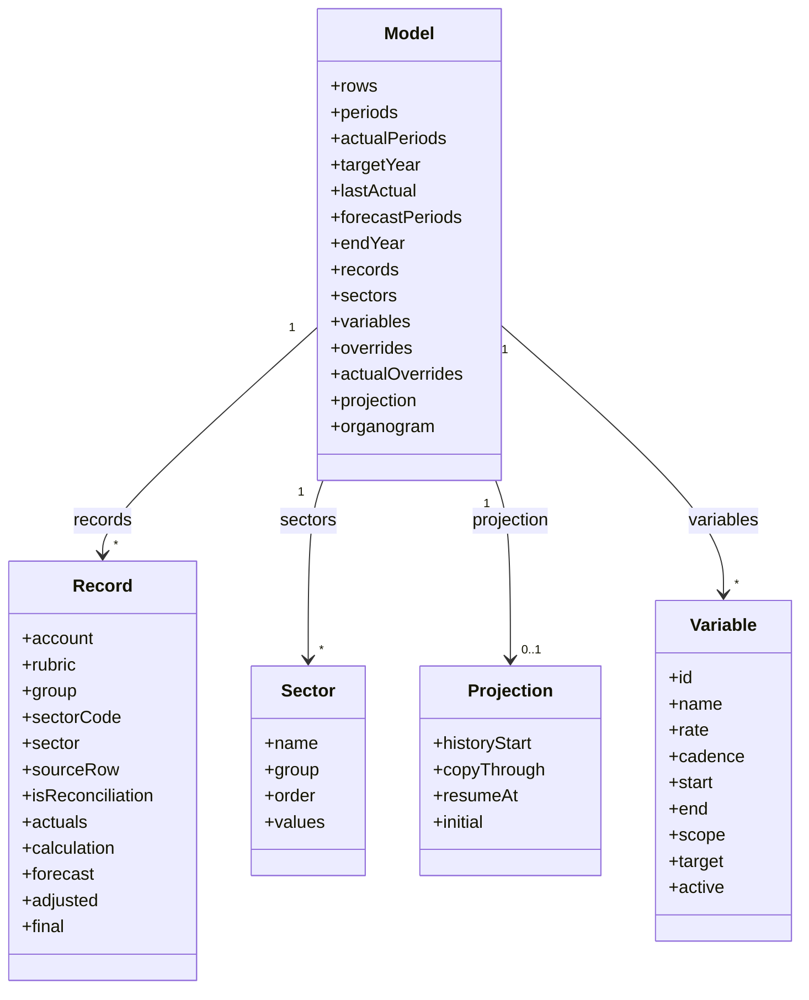

# Modelo de dados

Documenta as estruturas em memória e os formatos dos arquivos salvos.
<details>
<summary> Arquivos de código usados nesta página</summary>

Esta página foi escrita a partir destes arquivos:

- [budget.js](../../scripts/models/budget.js)
- [planning.js](../../scripts/export/planning.js)
- [organogram.js](../../scripts/models/organogram.js)
- [editor-state.js](../../scripts/models/editor-state.js)
- [budget-controller.js](../../scripts/controllers/budget-controller.js)

</details>


> **Páginas relacionadas**: [Cálculo do orçamento](04_calculo.md), [Organograma Orçamentário](05_organograma.md)

---

## Convenções

Regras válidas em todo o código:

| Convenção | Exemplo | Onde está |
|-----------|---------|-----------|
| Mês é texto `AAAA-MM`. Assim, comparar textos (`<`, `>`) é comparar datas. | `"2026-07" < "2026-10"` | `validMonth` ([budget.js](../../scripts/models/budget.js)), `monthKey` ([budget.js](../../scripts/models/budget.js)) |
| Conta de **14 dígitos** é analítica (vira linha editável). Conta de **10 dígitos** é total, setor ou subtotal. | `81830300010006` / `8180000004` | `normalizeRows` ([budget.js](../../scripts/models/budget.js)) |
| O 1º dígito da conta dá o grupo: **7 = Receita, 8 = Despesa**. | `7…` Receita | `GROUP_NAMES` ([budget.js](../../scripts/models/budget.js)) |
| Total do grupo: 10 dígitos com zeros da posição 2 à 9. | `7000000009` | `isGroupRoot` ([budget.js](../../scripts/models/budget.js)) |
| Setor da base: 10 dígitos com o 2º e o 3º não zero e as posições 4 a 9 zeradas; o último dígito é verificador. O código do setor são os 3 primeiros dígitos. | `8170000002` → `"817"` | `isSector` ([budget.js](../../scripts/models/budget.js)) |
| Edição manual usa a chave `"conta\|mês"`. | `"71100000010001\|2026-08"` | `periodValues` ([budget.js](../../scripts/models/budget.js)) |
| `null` = sem valor; `0` = valor zero. Na tela, sem valor aparece como `—`. | | `number()` ([budget.js](../../scripts/models/budget.js)) |
| Diferenças de até R$ 0,01 contam como zero. | `TOLERANCE` | [budget.js](../../scripts/models/budget.js) |
| Contas de ajuste começam com `AJUSTE-` e têm `isReconciliation: true`. | `AJUSTE-817` | `reconciliationRecord` ([budget.js](../../scripts/models/budget.js)) |

Sources: [budget.js](../../scripts/models/budget.js)

---

## Estruturas em memória



### Linha da base (entrada)

É o que `readSourceWorkbook` (chamada por `readBudgetWorkbook`) extrai da aba "Dados Analíticos" ([xlsx.js](../../scripts/export/xlsx.js)):

```js
{ sourceRow: 12, account: "81830300010006", rubric: "Provisão", values: { "2025-01": 60, "2025-02": null, ... } }
```

### Modelo (saída de `buildBudget`)

O modelo é montado em três etapas. Cada etapa acrescenta campos:

| Etapa | Função | Campos acrescentados |
|-------|--------|----------------------|
| Organizar | `organize` ([budget.js](../../scripts/models/budget.js)) | `rows`, `periods`, `availableActualPeriods`, `actualPeriods`, `targetYear`, `lastActual`, `records`, `sectors` |
| Projetar | `project` ([budget.js](../../scripts/models/budget.js)) | `forecastPeriods`, `forecastHistory`, `endYear`. Em cada conta, `calculation` e `forecast`. |
| Montar | `buildBudget` ([budget.js](../../scripts/models/budget.js)) | `variables`, `overrides`, `actualOverrides`, `projection`. Em cada conta, `adjusted` e `final`. |

`availableActualPeriods` lista todos os meses disponíveis do Realizado importado. `actualPeriods` seleciona os meses do cenário antes da classificação de contas e da conciliação. `record.actuals` contém os valores desse cenário. `rows` preserva a base completa.

O `controllers/app-controller.js` acrescenta `model.organogram` depois do cálculo ([app-controller.js](../../scripts/controllers/app-controller.js)).

O campo `calculation` guarda as parcelas do ajuste mensal. O campo `forecastHistory` lista os meses realizados que podem participar da mediana inicial, anteriores a **Ir até** e dentro do recorte.

Os três valores mensais da conta:

| Campo | Conteúdo |
|-------|----------|
| `record.forecast[mês]` | Projeção padrão, sem índices nem edições do Projetado. Considera as correções do Realizado nos meses da base e também alimenta a "Média padrão". |
| `record.adjusted[mês]` | `forecast` × fatores dos índices atuais. |
| `record.final[mês]` | O que vale: referência fixa na faixa fixa, edição manual ou `adjusted`. |

**Não leia `final` diretamente na interface.** Use `periodValues(model, record, mês)`. Ela também resolve o Realizado, as edições e a faixa de cópia ([budget.js](../../scripts/models/budget.js)).

`model.sectors` é um `Map` de código → `{ name, group, order, values }`. `order` é a ordem em que o setor aparece na planilha e define a ordem das linhas ([budget.js](../../scripts/models/budget.js)).

### Estado da página

`state` em [editor-state.js](../../scripts/models/editor-state.js). As entradas têm o mesmo formato do JSON salvo, e `state.model` é o modelo acima.

Sources: [budget.js](../../scripts/models/budget.js), [xlsx.js](../../scripts/export/xlsx.js), [editor-state.js](../../scripts/models/editor-state.js)

---

## Arquivos JSON

São três arquivos JSON, todos só com **entradas**:

### Planejamento (`orca-planejamento`, versão 8)

Criado por `createProject` ([planning.js](../../scripts/export/planning.js)):

```json
{
  "format": "orca-planejamento", "version": 8, "sourceName": "base.xlsx",
  "source": { "rows": [ /* linhas da base, sem "group" */ ], "periods": ["2025-01", "..."], "sheetName": "Dados Analíticos" },
  "endYear": 2046,
  "variables": [ /* índices */ ],
  "overrides": { "conta|mês": 123.45 },
  "actualOverrides": { "conta|mês": 99 },
  "projection": { "historyStart": "2025-07", "copyThrough": "2026-07", "resumeAt": "2026-08", "initial": null },
  "organogram": { "format": "orca-organograma", "version": 1, "boxes": [], "links": [] }
}
```

`restoreProject` valida tudo antes de calcular ([planning.js](../../scripts/export/planning.js)):

- formato e versão (aceita as versões 1 a 8);
- meses e números da base;
- cada chave `conta|mês` precisa apontar para uma conta existente, entre o primeiro mês disponível e dezembro do ano de referência mais 20, inclusive quando a edição fica fora do recorte exibido;
- o organograma passa por `validateOrganogram`.

O campo opcional `projection.historyStart` guarda **Começar em** como `AAAA-MM`. Sua ausência usa o primeiro mês do Realizado. Os valores anteriores e suas edições permanecem no JSON e voltam ao cenário se a data for antecipada.

Os valores salvos são limites efetivos: `copyThrough` é o último mês copiado e `resumeAt` é o primeiro mês dinâmico. A interface mostra "Ir até" um mês após `copyThrough` e "Retomar em" um mês antes de `resumeAt`. Isso preserva os cálculos dos projetos existentes. Arquivos sem `projection` usam o último realizado e o mês seguinte como limites efetivos.

O mesmo JSON vai escondido dentro do Excel exportado (aba `_Planejador`). Por isso o Excel do POU pode ser reaberto. Veja [Excel](06_excel.md).

### Índice (`variables[]`)

```json
{ "id": "uuid", "name": "IPCA", "rate": 4.5, "cadence": "annual", "start": "2026-08", "end": "2030-12",
  "scope": "group", "target": "Despesa", "active": true }
```

- `cadence`: `monthly` ou `annual`.
- `scope`: `all`, `group` (alvo `Receita`/`Despesa`), `sector` (alvo = código do setor da base) ou `account` (alvo = conta).

Validado por `validateVariables` ([budget.js](../../scripts/models/budget.js)).

O arquivo "Exportar índices" é `{ format: "orca-indices", exportedAt, variables }`, sem versão ([budget-controller.js](../../scripts/controllers/budget-controller.js)). A importação também aceita uma lista pura e chaves em português (`nome`, `taxa`, `ritmo`, `inicio`, `fim`, `alcance`, `alvo`) ([budget-controller.js](../../scripts/controllers/budget-controller.js)). O guia `docs/GUIA_LLM_INDICES_JSON.md` explica como pedir esse arquivo a uma IA.

### Organograma (`orca-organograma`, versão 1)

```json
{ "format": "orca-organograma", "version": 1,
  "boxes": [
    { "id": "auditoria", "name": "Gerência de Auditoria Interna", "parent": null },
    { "id": "presidencia", "name": "Presidência - PRESI", "parent": null },
    { "id": "ouvidoria", "name": "Ouvidoria", "parent": "presidencia" },
    { "id": "dpg", "name": "DIPLAG", "parent": "presidencia" }
  ],
  "links": [{ "id": "dpg:817", "box": "dpg", "type": "sector", "origin": "817", "percent": 4.545454 }] }
```

Formato documentado no topo de [organogram.js](../../scripts/models/organogram.js). Guia para IA: `docs/GUIA_LLM_ORGANOGRAMA_JSON.md`.

Sources: [planning.js](../../scripts/export/planning.js), [budget-controller.js](../../scripts/controllers/budget-controller.js), [organogram.js](../../scripts/models/organogram.js)

---
