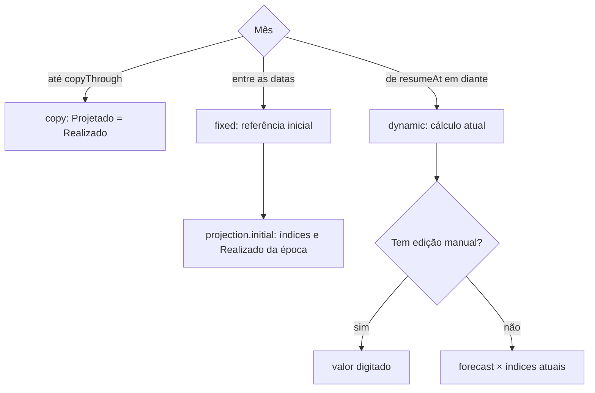

# Cálculo do orçamento

Explica a leitura da base, a projeção e a aplicação dos índices.
<details>
<summary> Arquivos de código usados nesta página</summary>

Esta página foi escrita a partir destes arquivos:

- [budget.js](../../scripts/models/budget.js)
- [fixtures.js](../../tests/fixtures.js)

</details>


> **Páginas relacionadas**: [Modelo de dados](03_modelo-de-dados.md), [Excel](06_excel.md)

Todo o cálculo está em `models/budget.js`, organizado de cima para baixo: utilitários, leitura da base, projeção, índices, montagem do modelo e consultas. A única função que a interface chama para calcular é `buildBudget` ([budget.js](../../scripts/models/budget.js)).

---

## Da planilha às contas (organize)

`organize(linhas)` transforma as linhas cruas da planilha em contas prontas para projetar ([budget.js](../../scripts/models/budget.js)). Cada etapa é uma função pequena e lança um erro em português quando a base não serve.


Leia de cima para baixo. Ao final, as contas estão vinculadas aos setores, conciliadas com os totais da planilha e prontas para a projeção. A tabela detalha as regras de cada etapa.

| Etapa | Regra | Código |
|-------|-------|--------|
| Limpar linhas | Mantém contas que começam com 7 ou 8, têm 10 ou 14 dígitos e têm descrição. Remove o `.0` que o Excel põe em códigos numéricos. | [budget.js](../../scripts/models/budget.js) |
| Recorte histórico | `historyStart` seleciona os meses realizados antes de classificar contas e criar os ajustes. A base completa permanece em `rows`. | [budget.js](../../scripts/models/budget.js) |
| Ano de referência | É o maior ano entre os meses da planilha (`targetYear`). | [budget.js](../../scripts/models/budget.js) |
| Meses obrigatórios | Precisa dos 12 meses do ano anterior e de janeiro a junho do ano de referência. | [budget.js](../../scripts/models/budget.js) |
| Último realizado | É o último mês em que os **dois** totais (Receita e Despesa) têm valor. Precisa estar entre junho e novembro. | [budget.js](../../scripts/models/budget.js) |
| Setores da base | Cada conta de setor vira uma entrada em `sectors`. Um nome iniciado por `(-)` perde o prefixo. | [budget.js](../../scripts/models/budget.js) |
| Contas analíticas | Cada conta de 14 dígitos recebe dois candidatos a setor: pelo **prefixo** do código e pela **posição** (o último setor visto acima dela na planilha). Conta repetida é erro. | [budget.js](../../scripts/models/budget.js) |
| Escolha do setor | O padrão é o prefixo. Se prefixo e posição discordam, a posição só vence quando faz os totais dos dois setores fecharem melhor (`assignmentScore`). | [budget.js](../../scripts/models/budget.js) |

**Por que dois candidatos?** Na planilha real, algumas contas têm código de um setor, mas aparecem sob o total de outro. O teste de pontuação escolhe a leitura que bate com os totais impressos.

Sources: [budget.js](../../scripts/models/budget.js)

---

## Ajustes de conciliação

A planilha traz totais que nem sempre batem com a soma das contas. Pode faltar detalhe na fonte, ou um subtotal pode ter valor próprio. O POU **não descarta essa diferença**: cria contas de ajuste (`AJUSTE-…`, `isReconciliation: true`). Com elas, contas + ajustes somam exatamente os totais da planilha.

São três camadas, nesta ordem. Cada uma só cobre o que a anterior não explicou ([budget.js](../../scripts/models/budget.js)):

| Ordem | Função | Diferença coberta | Conta criada |
|-------|--------|-------------------|--------------|
| 1 | `subtotalAdjustments` | Em Despesa, o setor não fecha num mês. Um subtotal intermediário tem sobra exatamente igual à falta. | `AJUSTE-<subtotal>`, com a descrição do subtotal ([budget.js](../../scripts/models/budget.js)) |
| 2 | `sectorAdjustments` | O total do setor da base ainda não fecha com suas contas. | `AJUSTE-<setor>` "Valores sem rubrica detalhada na fonte" ([budget.js](../../scripts/models/budget.js)) |
| 3 | `groupAdjustments` | O total de Receitas ou Despesas não fecha com a soma de todos os setores. | Setor artificial `R-SEM-SETOR`/`D-SEM-SETOR` e conta `AJUSTE-RECEITA`/`AJUSTE-DESPESA` ([budget.js](../../scripts/models/budget.js)) |

Os ajustes recebem `sourceRow` artificiais (999000+ e 999900+). Assim, ficam no fim do seu setor na ordenação final ([budget.js](../../scripts/models/budget.js)).

Ajustes são projetados como qualquer conta. Também podem ser editados e precisam de 100% no organograma. O que muda é que **não entram na mediana do setor**, para não distorcer a tendência ([budget.js](../../scripts/models/budget.js)).

Sources: [budget.js](../../scripts/models/budget.js)

---

## Projeção padrão (project)

Na primeira projeção de cada mês, o POU usa como base a mediana dos valores realizados da conta naquele mês do calendário. Entram todos os anos do recorte, de **Começar em** até o mês anterior a **Ir até**. A mediana considera zeros registrados e ignora células vazias. Em anos seguintes, a base é o valor padrão já projetado para o mesmo mês do ano anterior. [budget.js](../../scripts/models/budget.js)

Com uma referência disponível, o sistema soma o ajuste mensal à base e usa zero se o resultado for negativo. A base que passa para o ano seguinte é o valor padrão, antes de índices e edições manuais. [budget.js](../../scripts/models/budget.js)

```text
primeira previsão-base = max(0, mediana histórica do mês + ajuste mensal)
previsão-base nos anos seguintes = max(0, previsão-base do mesmo mês no ano anterior + ajuste mensal)
```

### Glossário do ajuste mensal

| Parcela | Cálculo |
| --- | --- |
| Mediana | Valor central após ordenar os valores. Com quantidade par, é a média dos dois valores centrais. |
| Ano de referência | Ano mais recente da planilha importada. |
| Variação da rubrica | Diferença entre os totais de janeiro a junho do ano de referência e do ano anterior, dividida por seis. |
| Variação do setor | Mediana das variações das contas do setor que tiveram pelo menos um valor de Realizado diferente de zero nos 12 meses comparados. Contas de conciliação ficam fora. Um setor sem contas elegíveis tem variação zero. |
| Tendência recente | Diferença entre os totais do segundo e do primeiro trimestre do ano de referência, dividida por três. |
| Desvio padrão populacional | Mede quanto os valores dos 12 meses dos dois primeiros semestres se afastam da média. É a raiz quadrada da média dos quadrados dessas diferenças. |
| Ajuste secundário | Mediana entre zero, a variação do setor e a tendência recente. Se setor e tendência apontarem em direções opostas, a mediana é zero. Se dois desvios padrão superarem R$ 0,01, o ajuste fica entre menos e mais esse limite. |
| Ajuste mensal | Soma da variação da rubrica com o ajuste secundário. |

Uma conta com movimento e variação zero participa da mediana do setor. Uma rubrica sem movimento nos dois primeiros semestres fica fora dessa mediana e continua disponível no orçamento. A mediana histórica da própria conta considera os zeros registrados. Para uma receita ou despesa futura sem histórico, registre a estimativa no Projetado com a premissa usada.

### Quando falta o mês no histórico

Se a conta estiver sem Realizado daquele mês em todos os anos do recorte, a primeira estimativa é a média dos até 12 meses de Realizado disponíveis antes de **Ir até**, limitada a zero se for negativa. Nessa média, valores vazios da conta contam como zero dentro dos meses selecionados. Uma janela vazia gera zero. O ajuste mensal passa a ser somado quando essa estimativa vira referência para o ano seguinte.

### Exemplo por conta

Se os janeiros realizados foram R$ 100, R$ 120 e R$ 140, a mediana de janeiro é R$ 120. Se os primeiros semestres totalizaram R$ 840 no ano de referência e R$ 720 no anterior, a variação da rubrica é (840 − 720) ÷ 6 = R$ 20. Com ajuste secundário zero, os janeiros projetados ficam em R$ 140, R$ 160 e R$ 180 antes dos índices.

Os índices do cenário multiplicam a previsão-base de cada conta no período. Depois de somar as contas, o resultado é o total das receitas menos o total das despesas. [Cálculo e totais](../../scripts/models/budget.js)

### Premissas e limites da previsão

A regra serve como cenário-base quando o padrão de cada mês e a evolução recente da conta continuam representativos. A mediana reduz o efeito de um valor excepcional na referência inicial. Uma despesa encerrada ainda pode aparecer se os valores históricos dela continuarem dominando a mediana.

O mesmo ajuste em reais é aplicado de um ano para o outro. Se ele refletir um evento isolado, seu efeito pode se acumular por vários anos. O limite de dois desvios atua no ajuste secundário. A variação principal da conta entra inteira. Meses ausentes nos semestres usados no ajuste contam como zero, inclusive quando a data de **Começar em** deixa um semestre incompleto.

Para medir a precisão com dados da agência, simule previsões para meses já encerrados usando somente informações disponíveis antes de cada previsão e compare com o que aconteceu por conta e no resultado total. Mover **Ir até** para trás com a base completa, por si só, pode dar uma impressão otimista. O ajuste semestral ainda pode ler valores realizados depois dessa data. Um resultado positivo em 2030 expressa as premissas do cenário. [Validação temporal de previsões](https://otexts.com/fpp3/toolbox.html#time-series-cross-validation)

---

## Índices econômicos

Um índice multiplica o Projetado por um fator acumulado ([budget.js](../../scripts/models/budget.js)):

```text
fator = (1 + taxa/100) ^ ocorrências
ocorrências = meses desde o início + 1          (mensal)
ocorrências = floor(meses desde o início / 12) + 1   (anual)
```

- Antes do início, o fator é 1. Depois do fim, o fator fica congelado no último valor.
- Exemplo: 10% mensal de 08/2026 a 10/2026 dá 1,10 em agosto, 1,21 em setembro e 1,331 de outubro em diante.
- Com a mesma vigência de agosto a outubro de 2026, um índice anual de 10% aplica apenas um reajuste: o fator fica em 1,10 de agosto de 2026 em diante. Para chegar a 1,21 em agosto de 2027, o mês final precisa alcançar agosto de 2027.
- Vários índices se multiplicam: dois de 10% dão 1,21 ([budget.js](../../scripts/models/budget.js)).
- O alcance (`scope`) escolhe as contas: todas, um grupo, um setor da base ou uma conta ([budget.js](../../scripts/models/budget.js)).
- Índice nunca altera o Realizado.

A tela recusa índice que começa antes de janeiro do ano de referência ([budget-controller.js](../../scripts/controllers/budget-controller.js)). O `validateVariables` recusa alvo inexistente ([budget.js](../../scripts/models/budget.js)).

Sources: [budget.js](../../scripts/models/budget.js)

---

## As três faixas e as edições manuais

**Começar em** inclui o mês escolhido e os seguintes. O POU seleciona os meses do recorte antes de atribuir contas a setores e calcular ajustes de conciliação. A mediana inicial, a tendência, a faixa fixa e os totais usam essa mesma base organizada. Para a mesma planilha, o cenário deve coincidir com o de uma importação que já veio sem as colunas antigas, desde que a planilha cortada ainda atenda às regras de importação e que os demais parâmetros sejam iguais.

A base original fica guardada para permitir mudar a data. Vínculos, índices e edições de ajustes que deixam de existir ficam guardados para caso a origem volte a aparecer. Enquanto a origem estiver ausente, esses itens ficam fora do cálculo. [Organização da base](../../scripts/models/budget.js)

Os limites efetivos `projection.copyThrough` (mês anterior à escolha "Ir até") e `projection.resumeAt` (mês seguinte à escolha "Retomar em") dividem o tempo em três faixas. `projectionKind` diz a faixa de cada mês ([budget.js](../../scripts/models/budget.js)):



- **Cópia:** o Projetado repete o Realizado do mês, inclusive o Realizado editado.
- **Fixa:** na primeira vez que o usuário cria um intervalo, `controllers/budget-controller.js` guarda em `projection.initial` uma cópia dos índices e das edições de Realizado daquele momento ([budget-controller.js](../../scripts/controllers/budget-controller.js)). `frozenReference` usa essas entradas e o recorte em vigor ([budget.js](../../scripts/models/budget.js)). Edições posteriores de valores e índices preservam a referência fixa.
- **Dinâmica:** usa índices e edições atuais. Projetado digitado (`overrides`) vence o cálculo ([budget.js](../../scripts/models/budget.js)).

O Realizado pode ser editado em qualquer mês, inclusive futuro (`actualOverrides`), mas o efeito depende do mês:

- **Mês realizado da base dentro do recorte** aceita edições de Realizado que podem mudar a projeção dinâmica ([budget.js](../../scripts/models/budget.js)).
- **Mês futuro, fora da base:** a edição aparece no Realizado e pode ser copiada pelo Projetado na faixa "Ir até". Ela não entra no cálculo da projeção dinâmica dos meses seguintes ([budget.js](../../scripts/models/budget.js)).

Se o usuário preencher o Realizado de um mês após o início da projeção, o valor fica disponível para comparação. A mediana inicial usa o histórico anterior a **Ir até**. Edições nos meses importados que participam dos primeiros semestres também podem alterar o ajuste mensal.

`validateProjection` exige um mês de Realizado em **Começar em**, até a escolha de **Ir até**. Também exige `copyThrough < resumeAt`, `resumeAt` até dezembro do horizonte e `initial` quando há meses fixos. [budget.js](../../scripts/models/budget.js)

Sources: [budget.js](../../scripts/models/budget.js), [budget-controller.js](../../scripts/controllers/budget-controller.js)

---

## Consultas usadas pela tela

| Função | Retorna | Código |
|--------|---------|--------|
| `periodValues(model, record, mês)` | `{ actual, projected }` exibidos, já com edições e faixas | [budget.js](../../scripts/models/budget.js) |
| `variance(realizado, projetado)` | (Realizado − Projetado) ÷ valor absoluto do Projetado. Vale para receitas, despesas e resultado. Quando o Projetado é zero ou falta base, devolve 0%. | [budget.js](../../scripts/models/budget.js) |
| `budgetLayout(model)` | Linhas da tabela: grupo → setor → contas | [budget.js](../../scripts/models/budget.js) |
| `totalsForPeriod(model, mês)` | Receita, Despesa e Resultado projetados do mês | [budget.js](../../scripts/models/budget.js) |
| `standardAverage(model, ano)` | Média mensal do resultado da projeção padrão: ignora índices e edições do Projetado, mas considera correções do Realizado nos meses da base | [budget.js](../../scripts/models/budget.js) |
| `periodsForYear(model, ano)` | Meses exibidos no ano | [budget.js](../../scripts/models/budget.js) |
| `modelYears(model)` | Anos do primeiro realizado ao fim do horizonte | [budget.js](../../scripts/models/budget.js) |
| `parseMoney(texto)` | `"R$ 1.234,56"` → `1234.56`; vazio → `null` | [budget.js](../../scripts/models/budget.js) |

`HORIZON_YEARS = 20` limita o ano final a 20 anos depois do ano de referência ([budget.js](../../scripts/models/budget.js)).

A **Média padrão** não é uma cópia imutável da planilha original. Ao corrigir o Realizado histórico, a projeção padrão é recalculada e essa média pode mudar. Índices econômicos e valores digitados no Projetado não entram nela.

Sources: [budget.js](../../scripts/models/budget.js)

---
