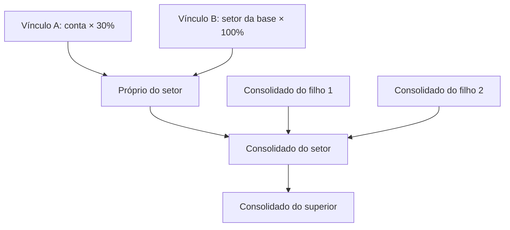

# Organograma Orçamentário

Descreve setores, distribuição de contas e consolidação dos valores.

 Arquivos de código usados nesta página

Esta página foi escrita a partir destes arquivos:

- [organogram.js](../../scripts/models/organogram.js)
- [organogram-controller.js](../../scripts/controllers/organogram-controller.js)
- [organogram-search-view.js](../../scripts/views/organogram-search-view.js)
- [organogram-visual.js](../../scripts/views/organogram-visual.js)

> **Páginas relacionadas**: [Cálculo do orçamento](04_calculo.md), [Excel](06_excel.md)

---

## Conceitos

O organograma responde a uma pergunta: **qual setor administrativo responde por cada valor realizado?** Ele trabalha só com o Realizado, nunca com o Projetado ([organogram.js](../../scripts/models/organogram.js)).

| Peça | Formato | Significado |
|------|---------|-------------|
| `box` | `{ id, name, parent, parents? }` | Setor administrativo (Presidência, Gerência…). `parent: null` é raiz; `parents` lista todos os superiores diretos quando houver mais de um. |
| `link` | `{ id, box, type, origin, percent }` | Vínculo: `percent`% da origem vão para o `box`. |
| `type: "account"` | `origin` = código da conta | Vale para uma conta. |
| `type: "sector"` | `origin` = código do setor da base | Vale para **todas** as contas daquele setor da base ([organogram.js](../../scripts/models/organogram.js)). |

O formato completo está no comentário do topo de [organogram.js](../../scripts/models/organogram.js).

**Organograma padrão AGE:** 24 setores fixos. CONAD, CONFIN, Gerência de Auditoria Interna e CPL são raízes independentes, no mesmo nível da Presidência. Ouvidoria e DIPLAG são filhos diretos da Presidência. A Gerência de Pequenos Negócios aparece uma única vez, sob sua superintendência ([organogram.js](../../scripts/models/organogram.js)). Cada setor recebe `100 ÷ 24` de cada setor da base ([organogram.js](../../scripts/models/organogram.js)). Os quatro setores independentes entram no total geral e ficam fora do consolidado da Presidência. Como a divisão não é exata, a regra dos 100% usa tolerância.

`addSuperior` cria um setor acima de outro. Se o filho tinha um único superior, o novo setor fica entre os dois: herda o superior antigo e passa a ser o superior direto do filho. Se o filho já tinha vários superiores, o novo é acrescentado e as ligações diretas anteriores são preservadas. Se o filho era raiz, passa a ficar abaixo do novo setor. Assim, a hierarquia pode ser montada de baixo para cima ([organogram.js](../../scripts/models/organogram.js)).

Sources: [organogram.js](../../scripts/models/organogram.js)

---

## Validação e regra dos 100%

Existem duas verificações diferentes, de propósito:

| Verificação | Quando | O que confere | Código |
|-------------|--------|---------------|--------|
| `validateOrganogram` | Sempre: ao editar, importar, salvar e abrir | Formato, ids únicos, nome até 120 caracteres, superiores existentes, **sem ciclos**, origem existente e percentual ≥ 0 | [organogram.js](../../scripts/models/organogram.js) |
| `allocationIssues` | Antes de exportar o Excel e na lista de pendências | A soma dos vínculos de cada conta arredonda para 100% na mesma precisão da tela: até duas casas decimais | [organogram.js](../../scripts/models/organogram.js) |

Por isso, **rascunho incompleto pode ser salvo em JSON**, mas não vira Excel ([app-controller.js](../../scripts/controllers/app-controller.js), [xlsx.js](../../scripts/export/xlsx.js)).

A validação elimina ruído além da oitava casa decimal e arredonda a soma para duas casas, como a apresentação. Somas de 99,996% e 100,004% permitem exportar; 99,99% e 100,01% continuam gerando pendência. Essa tolerância não altera vínculos, percentuais ou valores calculados e não redistribui diferenças automaticamente.

Cada organograma aceita **até 500 setores administrativos e 10.000 vínculos**. Arquivos acima desses limites são recusados, mesmo que os demais campos estejam corretos. Os limites também valem para os arquivos produzidos com ajuda de IA ([organogram.js](../../scripts/models/organogram.js)).

A busca de ciclo sobe por **todos** os superiores de cada setor. Revisitar um setor no mesmo caminho é ciclo; caminhos diferentes podem alcançar o mesmo superior ([organogram.js](../../scripts/models/organogram.js)).

Uma conta pode receber percentuais de vínculos de **conta** e de **setor da base** ao mesmo tempo. Eles se somam. `allocationBreakdown` lista os dois tipos para a janela "Detalhes" ([organogram.js](../../scripts/models/organogram.js)).

`validateOrganogram` devolve uma cópia só com os campos salvos. Valores calculados nunca entram no JSON ([organogram.js](../../scripts/models/organogram.js)).

Sources: [organogram.js](../../scripts/models/organogram.js)

---

## Valor próprio e consolidado

`organogramValues(config, model, ano)` calcula, mês a mês ([organogram.js](../../scripts/models/organogram.js)):

- **Valor do vínculo** = Realizado de cada conta alcançada × `percent / 100`, separado em Receita, Despesa e Resultado.
- **Próprio** = soma dos vínculos do setor.
- **Consolidado** = soma do próprio setor e de cada setor alcançado, uma única vez; `members` guarda os IDs alcançados ([organogram.js](../../scripts/models/organogram.js)).
- **Total** = união dos setores alcançados pelas raízes, também sem duplicar.

Consolidar **não gasta percentual de novo**. Os 100% valem só nos vínculos diretos. O superior apenas soma o que já foi atribuído abaixo dele.

`expenseView` prepara os dados do visual: valores próprios e consolidados de cada setor, as fatias da rosca (só valores próprios **positivos**) e `credits` (estornos negativos, que ficam fora das fatias) ([organogram.js](../../scripts/models/organogram.js)).

Sources: [organogram.js](../../scripts/models/organogram.js)

---

## Tela do organograma

Um controller e três views dividem a aba:

| Módulo | Partes da tela |
|--------|----------------|
| `controllers/organogram-controller.js` | Eventos dos filtros e formulários, criação e remoção de setores e vínculos, importação e confirmação das edições ([organogram-controller.js](../../scripts/controllers/organogram-controller.js)) |
| `views/organogram-view.js` | Formulários, seletores, pendências, vínculos e tabela mensal ([organogram-view.js](../../scripts/views/organogram-view.js)) |
| `views/organogram-search-view.js` | Busca de receita ou despesa e janela de editar ou remover vínculos ([organogram-search-view.js](../../scripts/views/organogram-search-view.js)) |
| `views/organogram-visual.js` | Rosca, ranking, árvore e captura PNG, com dica de valores ([organogram-visual.js](../../scripts/views/organogram-visual.js)) |

**Toda edição passa por `commit(edit)`** ([organogram-controller.js](../../scripts/controllers/organogram-controller.js)):

1. Copia o organograma (`structuredClone`).
2. Aplica a edição na cópia.
3. Valida e calcula os valores, para pegar estouro numérico.
4. Só então troca `state.organogram` e chama `changed(before)`, que grava o histórico e recalcula.

Se qualquer passo falhar, o organograma atual não é tocado. A seleção volta ao valor anterior e a mensagem de erro aparece. Os botões das tabelas e da janela de vínculos usam o mesmo `commit` ([organogram-search-view.js](../../scripts/views/organogram-search-view.js)).

Outros detalhes:

- A busca usa `matchesSearch`: cada palavra digitada precisa aparecer, sem diferenciar acentos nem maiúsculas ([dom.js](../../scripts/views/dom.js)). O texto pesquisável inclui grupo, código, descrição e setor da base ([organogram.js](../../scripts/models/organogram.js)). A lista mostra no máximo 50 resultados ([organogram-search-view.js](../../scripts/views/organogram-search-view.js)).
- O formulário aceita vários superiores no mesmo campo. Remover um setor liga cada filho aos superiores remanescentes e aos superiores do setor removido, apagando só os vínculos diretos dele ([organogram-controller.js](../../scripts/controllers/organogram-controller.js)).
- A árvore visual repete uma `box` nos caminhos de cada superior múltiplo quando uma estrutura personalizada usar essa relação; os dados e o Excel continuam deduplicados.
- "Usar organograma padrão AGE" substitui a estrutura e pede confirmação quando já existem setores ([organogram-controller.js](../../scripts/controllers/organogram-controller.js)). "Importar organograma JSON" substitui a estrutura assim que o arquivo é validado, sem uma confirmação adicional. Salve o organograma atual antes de importar outro; a troca pode ser desfeita pelo histórico enquanto a mesma base continuar aberta ([organogram-controller.js](../../scripts/controllers/organogram-controller.js)).
- A cor de cada setor depende da ordem de cadastro e é igual na rosca, no ranking, na árvore e no Excel ([organogram-visual.js](../../scripts/views/organogram-visual.js)).
- Na árvore, cada setor tem uma barra de **Receita** e outra de **Despesa**. Em cada barra, a parte clara é o valor direto do setor e a escura é o valor indireto consolidado dos filhos; a legenda da tela identifica verde claro/escuro para receita e laranja claro/escuro para despesa ([organogram-visual.js](../../scripts/views/organogram-visual.js), [index.html](../../index.html)).
- Cada cartão da árvore é um botão. Ao clicar, ou ao ativá-lo com Tab + Enter/Espaço, o setor vira a seleção do campo **Vincular ao setor administrativo**; a lista de vínculos é atualizada e o cartão fica destacado ([organogram-controller.js](../../scripts/controllers/organogram-controller.js), [organogram-visual.js](../../scripts/views/organogram-visual.js)).
- **Vínculos deste setor** é uma seção recolhível fechada por padrão. O resumo abre e fecha a lista de vínculos com mouse ou teclado, mantendo a consulta e a edição sem ocupar espaço visual quando não estiverem em uso ([index.html](../../index.html), [styles/styles.css](../../styles/styles.css)).
- **Tirar foto PNG** captura a árvore inteira, inclusive o conteúdo fora do scroll horizontal, redesenhando cartões, conectores, valores e barras no PNG sem dependência externa ([organogram-controller.js](../../scripts/controllers/organogram-controller.js), [organogram-visual.js](../../scripts/views/organogram-visual.js)).

Sources: [organogram-controller.js](../../scripts/controllers/organogram-controller.js), [organogram-search-view.js](../../scripts/views/organogram-search-view.js), [organogram-visual.js](../../scripts/views/organogram-visual.js)

---

## Casas decimais dos vínculos

A lista de vínculos, a busca e os campos de edição mostram duas casas decimais: 4,333% aparece como 4,33%; 3,999% aparece como 4,00%. A mesma regra de arredondamento é compartilhada pela apresentação e pela validação dos 100%.

Ao confirmar uma edição ou criar um vínculo, o percentual informado é arredondado para duas casas. Vínculos antigos e importados conservam a precisão original nos cálculos enquanto não forem editados; exibir duas casas não altera esses valores automaticamente.
